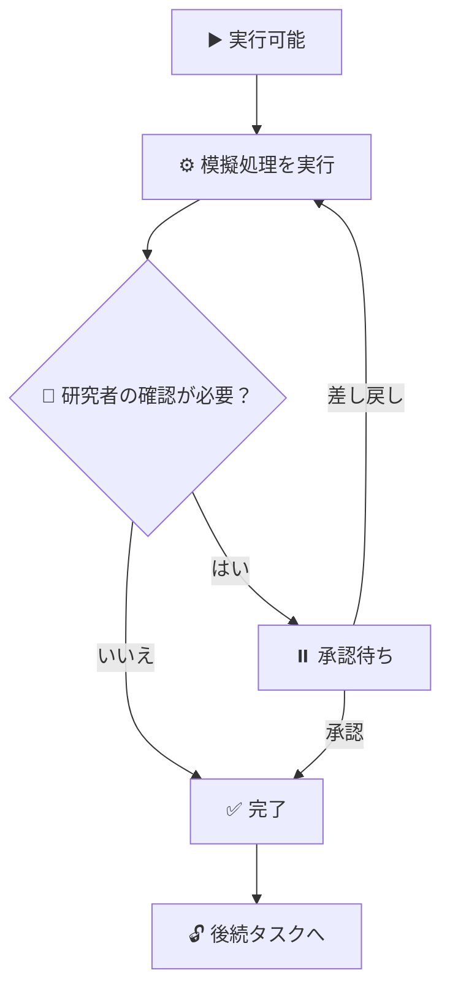

<div align="center">

# 🔬 RIHRP Research Studio
### 研究の「問い」と「根拠」をつなぐ、建設・土木のリサーチスタジオ

**研究職の技術者・建設土木分野の大学院生へ。**  
仮説を整理し、反対意見も確かめ、研究の過程を説明できる報告書へ。


[](LICENSE)

[🚀 利用画面を開く](https://research.mirai-dx-platform.com) · [🧭 はじめ方](#start) · [🔄 6つのステップ](#workflow) · [🏗️ 活用例](#examples) · [🛠️ 開発・運用情報](#engineering)

</div>

> [!NOTE]
> **はじめての方へ**  
> 利用画面はアクセスを許可された方が対象です。管理者から案内された方法でログインしてください。通常の利用にプログラミングは必要ありません。

> [!IMPORTANT]
> **現在の研究スタジオは、研究の進め方を体験・整理するシミュレーションです。**  
> 画面の「AIエージェント」「複数AI討論」は、あらかじめ用意したルールで動きます。実際のAIモデルによる推論ではありません。内蔵資料・事例は**架空の模擬データ**、評価点は**例示用の指標**です。研究成果として扱う前に、実在する原資料と実験・解析で確かめてください。

<a id="overview"></a>

## 💡 どんなときに役立つ？

「何を確かめたいのか」「その根拠は何か」「別の説明はないか」を、ひとつの研究テーマにまとめて整理できます。

| 🤔 研究でよくある悩み | ✨ スタジオで整理できること |
|---|---|
| テーマが広く、実験の目的が定まらない | 対象・条件・比較方法を含む仮説を書き出す |
| 資料は集まったが、結論との関係が曖昧 | 仮説を支持する資料・反証する資料を分ける |
| 自分の仮説に都合のよい情報だけを見てしまう | 批判や代替案に目を向け、見落としを点検する |
| 複数の研究案から選ぶ理由を説明しづらい | 評価の重みを変え、選択理由を考える |
| ゼミや研究会の報告に毎回手間がかかる | 仮説・根拠・討論・判断を報告書の草案にまとめる |

🧑‍🔬 **研究職の技術者**：技術課題の整理、試験計画の検討、社内研究会の準備に。  
🎓 **大学院生**：研究テーマの具体化、反証の検討、ゼミ発表の下準備に。  
👥 **指導・レビュー担当者**：結論だけでなく、根拠と判断の過程を確認する入口に。

<a id="start"></a>

## 🚀 はじめ方 ― まずは仮説を1つ書いてみる

1. **🌐 利用画面を開く**  
   [RIHRP Research Studio](https://research.mirai-dx-platform.com)にアクセスし、案内された認証を済ませます。アクセスできない場合は管理者に利用権限を確認してください。
2. **📁「＋ 新規研究」を選ぶ**  
   テーマ名と、確かめたい仮説を入力します。
3. **✍️ 比較対象と測定項目を加える**  
   「何を、どの条件で、何と比べ、どの指標で評価するか」を書きます。
4. **▶️「AIタスク管理」で流れを体験する**  
   実行状況を見ながら進め、承認待ちになったら内容を確認します。ここでのタスク実行はシミュレーションです。
5. **📄「研究報告書」で全体を読み返す**  
   草案を保存し、実際に確認する資料・追加する試験・指導者に相談する点を整理します。

> 💡 **入力例（研究計画を考えるための仮の例）**  
> 「同じ配合・養生条件のコンクリートで、養生方法AとBを比較し、材齢28日の圧縮強度と表面ひび割れの発生状況を評価する。」  
> 最初から立派な結論は不要です。**確かめられる問い**から始めましょう。

### 💾 保存状態も確認しましょう

| 表示・操作 | 意味 |
|---|---|
| ☁️「サーバーに自動保存済み」 | Web版で編集した研究データの保存が完了 |
| ⚠️「保存に失敗しました」 | 保存できていない状態。接続を確認し、保存済み表示を確かめる |
| 📦「JSON保存」 | 研究データをファイルとして控える |
| 📂「JSON読込」 | 保存した研究データを取り込む |

Web版はサーバーへの接続が必要です。画面に「Offline Demo」と表示されても、Web版の自動保存がオフラインで完了するわけではありません。

<a id="workflow"></a>

## 🔄 研究を進める6つのステップ

<div align="center">


</div>

| ステップ | 🖱️ 画面で行うこと | 🎯 持ち帰れるもの |
|---|---|---|
| **01 ✍️ 研究仮説登録** | 研究テーマと仮説を入力し、必要に応じて改訂を記録 | 何を確かめたいかが伝わる研究の出発点 |
| **02 ⚙️ AIタスク管理** | 依存関係のある10件の模擬タスクを実行し、進捗・承認待ちを確認 | 研究に必要な作業と順序の見通し |
| **03 💬 複数AI討論** | 8体の模擬エージェントによる討論を読み、自分の意見を入力 | 仮説に対する批判・条件変更・代替案の論点 |
| **04 📚 根拠・反証** | 資料を見比べ、支持・反証・中立を整理し、資料を手動追加 | 仮説を支える情報と、揺さぶる情報の一覧 |
| **05 ⚖️ 新仮説比較** | 候補とレーダーチャートを見て、評価の重みや採否を検討 | どの仮説を選び、なぜ選ぶかという判断材料 |
| **06 📝 研究報告書** | 仮説から判断までをまとめた草案を確認・保存 | ゼミや研究会で検討するための報告書のたたき台 |

> 🧭 **画面の点数やランキングは、研究者の判断を支える例示です。**  
> 点数が高いだけで、仮説の正しさ・研究の新規性・施工への適用性が確認されたことにはなりません。

<details>
<summary>▶️ タスクはどう進む？ ― 実行・確認・差し戻しの流れを見る</summary>

実行可能なタスクから模擬処理が進み、一部のタスクは研究者の確認を待ちます。内容を確認し、承認するか、差し戻して再実行します。



「承認」は、画面の内容を確認して次へ進める操作です。科学的な正しさを証明する操作ではありません。

</details>

<details>
<summary>💬 複数AI討論をどう読む？ ― 反対意見を研究の改善に使う</summary>

討論はルールに基づく模擬応答です。次の観点で読むと、実際の研究計画に持ち帰れる問いが見つかります。

- 🔍 **根拠**：その説明を裏付ける原資料はあるか。
- 🧪 **検証方法**：実験・解析・観測で確かめられるか。
- 🧩 **別の説明**：他の要因でも同じ結果になるのではないか。
- 📏 **適用範囲**：材料・地盤・流量・施工条件が変わっても成り立つか。
- 🧑‍🔬 **研究者の発言**：反論や追加条件を入力し、論点の変化を確認する。

模擬エージェントの同意や合意度は、査読や専門家による評価の代わりにはなりません。

</details>

<details>
<summary>⚖️ 仮説比較をどう使う？ ― 順位よりも、選択理由に注目する</summary>

評価軸には、根拠・検証可能性・研究負担・重要性・新規性があります。重みを変えると、候補の順位が変わる場合があります。

| 考える場面 | 確認すること |
|---|---|
| 🎓 修士研究の計画 | 研究期間内に測定・検証できるか |
| 🏗️ 現場課題の検討 | 実験設備・施工条件・データ収集に無理がないか |
| 🔬 新しい研究テーマの検討 | 既往研究との差分を原論文で説明できるか |

スコアは例示であり、実験結果や網羅的な文献調査から自動的に確定した評価ではありません。

</details>

<a id="examples"></a>

## 🏗️ 建設・土木研究では、こんな問いから始められます

以下は**入力テーマの例**です。このシステムが実験・解析を実行したり、示した効果を実証したりするものではありません。

| 分野 | 🔬 仮説・問いの例 | 📏 実研究で確認する資料・指標の例 |
|---|---|---|
| 🌊 河川・水工 | 根固め工の配置を変えると、護岸近傍の洗掘はどう変わるか | 水理実験、流速分布、最大洗掘深、流量条件 |
| ⚓ 港湾・海洋 | 消波工の配置によって、越波量や背後域の波高はどう変わるか | 水理模型実験、越波量、波高、潮位条件 |
| 🪨 地盤 | 地盤改良条件の違いで、沈下量と強度はどう変わるか | 土質試験、圧密試験、現場計測、地層条件 |
| 🧱 コンクリート | 養生条件を変えると、強度とひび割れはどう変わるか | 材料試験、温度履歴、圧縮強度、ひび割れ幅 |
| 🌉 構造・維持管理 | 点検方法の違いで、損傷の見逃しと作業時間はどう変わるか | 点検記録、現地照合、見逃し率、点検時間 |
| 🚧 施工・生産性 | 施工手順を変えると、待ち時間と品質のばらつきはどう変わるか | 作業観測、工程記録、待ち時間、品質検査 |
| 🌱 環境 | 施工条件の違いによる環境影響を、どう比較できるか | 観測記録、濁度・騒音等、背景条件、測定方法 |

> 🔎 **研究のコツ**：「よくなった」だけで終わらせず、**何が・何と比べて・どの条件で・どれだけ変わったか**まで確かめると、議論が具体的になります。

<a id="evidence"></a>

## 🔗 「どの資料の、どの記述か」をたどる

このリポジトリには、6ステップの研究スタジオに加えて、**出典と主張を結び付けて確認する機能**があります。両者の確認方法は異なります。

| 機能 | 確認すること |
|---|---|
| 🧭 **研究スタジオ** | 仮説・模擬討論・根拠・候補比較を整理する。スコアは例示 |
| 🔗 **出典・主張・レポートの検証機能** | 登録した資料本文に引用や数値が存在するか、保存した本文が変わっていないかを確認する |

### 📖 まずは、この4つの言葉だけ

| 言葉 | やさしい説明 | 例 |
|---|---|---|
| 📚 **出典** | 情報を取り出した元の資料 | 論文、技術報告書、観測記録 |
| 💬 **主張** | レポートで伝えたい内容 | 「条件Aでは指標Bが変化した」 |
| 🔖 **引用** | 資料から、そのまま抜き出した文章 | 結果を述べた段落 |
| 🔗 **根拠** | 主張を裏付けるために結び付けた出典・引用 | 主張と資料の該当箇所の対応 |

### 🚦 検証結果の読み方

| 表示 | 何を表す？ | 研究者が確認すること |
|---|---|---|
| 🟢 **確認済み（verified）** | ルール上、引用と数値の存在を確認できた | 原資料の文脈・条件と、主張の意味が合っているか |
| 🟡 **未検証（unverified）** | 主張内の数値を根拠本文で確認できない | 数値・単位・引用箇所を見直す |
| 🔴 **矛盾あり（contradicted）** | 引用が見つからない、または保存本文の変更等を検出した | 該当する出典と引用を確認する |
| ⚪ **根拠不足（insufficient）** | 根拠がない、または引用・数値による確認ができない | 確認できる資料と引用を追加する |

> [!IMPORTANT]
> **🟢 確認済み ＝ 科学的に正しい、ではありません。**  
> この検証は、引用・数値の存在や保存本文の一致をルールで確認するものです。因果関係、統計的な妥当性、原資料の信頼性、新規性、設計基準への適合までは保証しません。  
> レポートの承認条件は**矛盾あり0件**です。未検証・根拠不足が残っていても承認できるため、残件数と内容を確認してください。これは、研究スタジオ内で模擬タスクを進める「承認」とは別の機能です。

<a id="outputs"></a>

## 📤 何を持ち帰れる？

<div align="center">


</div>

| 持ち帰るもの | 形式・方法 | 使いどころ |
|---|---|---|
| 📝 研究スタジオの報告書草案 | HTML・テキスト | ゼミ、研究会、検討メモ |
| 🖨️ 印刷用の報告書 | ブラウザの「印刷 / PDF」 | 配布資料、PDFとしての控え |
| 📦 研究データ | JSON保存・読込 | データの控え、再読込 |
| 🔗 出典・主張の検証機能で作成したレポート | Markdown（検証マーカー・根拠付録付き） | 出典と主張の対応を確認する資料 |

**🧑‍🔬 報告書は草案として読み返しましょう。**  
模擬データを実在する研究成果として引用せず、実際の文献・試験結果・解析条件に照らして修正してください。

<a id="screens"></a>

## 🖼️ 画面のイメージ

以下は、出典・主張・レポートの検証機能のスクリーンショットです。6ステップの研究スタジオとは画面構成が異なります。

| 🔐 ログイン | 📊 ダッシュボード |
|---|---|
|  |  |

<details>
<summary>🖱️ もっと見る ― 主張の確認・レポート編集</summary>

| 🔗 主張と根拠の確認 | 📝 レポート編集 |
|---|---|
|  |  |

</details>

<a id="faq"></a>

## 🙋 よくある質問

<details>
<summary>🎓 プログラミングができなくても使えますか？</summary>

通常の画面操作にプログラミングは必要ありません。研究テーマや仮説を文章で入力し、画面のボタンや選択欄で進めます。システムの導入・保守は管理者が担当します。

</details>

<details>
<summary>🤖 ChatGPTなどのAIが、実際に論文を読んで討論しますか？</summary>

現在の研究スタジオの討論は、ブラウザ内のルールに従うシミュレーションです。実際のAIモデルが推論したり、外部の論文を自動検索して読み込んだりする機能ではありません。

</details>

<details>
<summary>📚 内蔵の論文・資料を、そのまま研究で引用できますか？</summary>

内蔵資料・事例は架空の模擬データです。実際の文献として引用しないでください。研究で使う場合は、原論文・公的機関の資料・実測データ等を自分で確認し、実データと模擬データを区別してください。

</details>

<details>
<summary>📎 PDFやWord、論文のURLを入れるだけで、本文を自動取得できますか？</summary>

出典検証機能では、PDF・Officeファイルの本文抽出と、外部URLからの本文自動取得は未実装です。URLやDOIは資料の識別情報として扱い、確認対象の本文はテキストで登録します。

</details>

<details>
<summary>✅ 承認された報告書は、そのまま論文投稿や設計判断に使えますか？</summary>

承認だけで、学術的妥当性や設計上の安全性が保証されるわけではありません。原資料との照合、適用条件の確認、専門家・指導者によるレビューを行ってください。出典検証機能では、未検証・根拠不足が残っていても承認できます。

</details>

<details>
<summary>👥 指導教員や共同研究者と同時に編集できますか？</summary>

利用者の役割に応じた閲覧・編集・レビュー機能があります。ただし、リアルタイム共同編集や、研究テーマごとのメンバー権限管理は未実装です。利用範囲と権限は管理者に確認してください。

</details>

<details>
<summary>💻 インターネットなしで利用できますか？</summary>

Web版はサーバーへの接続が必要です。別途、単体HTMLのオフラインデモもリポジトリに含まれていますが、Web版の認証・サーバー保存とは異なります。通常は管理者から案内されたWeb版を利用してください。

</details>

<a id="license"></a>

## 📜 ライセンス

**本ソフトウェアは [MIT License](LICENSE) です。**

---

<a id="engineering"></a>

## 🛠️ エンジニア・管理者向け情報（最後にまとめて掲載）

ここからは、導入・開発・運用を担当する方向けの情報です。

<details>
<summary>📦 技術構成・コードの場所</summary>

| 場所 | 内容 |
|---|---|
| `apps/api/rihrp/` | FastAPI / Python 3.12 / SQLAlchemy 2 / psycopg |
| `apps/web/` | React 18 / TypeScript / Vite / Node 22 |
| `apps/web/src/studio/` | 6ステップの研究スタジオ。模擬処理は `engine.js` |
| `RIHRP_Offline_Research_Studio.html` | 単体HTMLのオフラインデモ |
| `infra/migrations/` | Alembic / PostgreSQL 16 |
| `infra/db/` | DB bootstrap・backup・restore検証・OpenAPI出力 |
| `infra/native/` | systemd user unit・health check・運用スクリプト |
| `tests/` | 単体・結合テスト。テストDBは `rihrp_test*` のみ |
| `docs/` | 企画・要件・設計・ADR・Runbook・検証記録 |

Webのビルド成果物はAPIから同一オリジンで配信します。研究状態は `research_documents` に保存します。ログイン後の既定画面は `/studio`、既存のダッシュボードは `/dashboard` です。

</details>

<details>
<summary>🚦 検証ルール・承認・セキュリティ</summary>

出典・主張の検証にLLMは使いません。根拠スナップショットのSHA-256を再計算し、引用・数値の存在をルールで判定します。

| 条件 | 判定 |
|---|---|
| 根拠0件 | `insufficient` |
| SHA-256不一致、引用がスナップショットに存在しない | `contradicted` |
| 主張内の数値が根拠本文に見つからない | `unverified` |
| 引用が実在し、主張内の数値もすべて実在する | `verified` |
| 引用も数値もない | `insufficient` |

- レポートの `approved` は `contradicted = 0` が必須。承認時に再検証し、未検証・不足の残数をUIとエクスポートに残します。
- 提出者本人の承認を拒否し、差し戻しにはコメントが必要です。
- 役割は viewer / editor / reviewer / admin。プロジェクト単位のメンバー管理・複数テナント分離は未実装です。
- Argon2id、DBセッション、HttpOnly / SameSite=Lax Cookie、本番ではSecure。状態変更APIにCSRFトークン必須。
- 監査ログは業務操作と同一トランザクションに記録。DBトリガーで更新・削除・TRUNCATEを保護します。
- 秘密情報はリポジトリ外に保存。`.env*` や接続文字列をコミットしません。
- 本番前段はCloudflare Tunnel + Access。`RIHRP_TRUST_CF_ACCESS=true` の場合、Access JWTのRS256署名・iss・aud・期限とemail allowlistを検証してセッションを発行します。平文emailヘッダーは信頼しません。
- 汎用SSO / OIDC連携は未実装です。Cloudflare Access経由の認証連携とは区別してください。

詳細：[検証規則](docs/adr/0002-deterministic-verification.md) / [承認規則](docs/adr/0003-approval-rule.md) / [認証](docs/adr/0004-auth-session.md) / [監査ログ](docs/adr/0005-audit-append-only.md)

</details>

<details>
<summary>💻 ローカル開発・テスト</summary>

前提：Python 3.12、Node 22、ローカルPostgreSQL 16。DBはネイティブ運用です。

```bash
# 初回DB作成
RIHRP_DB_PASSWORD='<ローカル用パスワード>' infra/db/bootstrap.sh rihrp rihrp_app

# 開発用設定はリポジトリ外に作成
mkdir -p ~/.config/rihrp
cat > ~/.config/rihrp/rihrp.conf <<'EOF'
RIHRP_ENV=development
RIHRP_DATABASE_URL=postgresql+psycopg://rihrp_app:<パスワード>@127.0.0.1:5432/rihrp
RIHRP_SEED_DEMO=true
RIHRP_COOKIE_SECURE=false
EOF

# この例の管理者作成済み設定を、実行するシェルに読み込む
set -a
. ~/.config/rihrp/rihrp.conf
set +a

python3 -m venv .venv
.venv/bin/pip install -e ".[dev]"
(cd infra/migrations && alembic upgrade head)
(cd apps/web && npm ci && npm run build)

RIHRP_DATABASE_URL='postgresql+psycopg://rihrp_app:<パスワード>@127.0.0.1:5432/rihrp' \
  .venv/bin/uvicorn rihrp.main:app --app-dir apps/api --host 127.0.0.1 --port 18110
```

設定ファイルを読み込む際は、管理者が作成・管理した内容であることを確認してください。

- 画面：`http://127.0.0.1:18110`
- Health / Readiness：`/healthz` / `/readyz`
- API仕様：`docs/api/openapi.yaml`
- デモ利用者は `RIHRP_SEED_DEMO=true` に加え `RIHRP_SEED_PASSWORD` の設定が必要。本番はseedを無効化します。

```bash
# テストDBを初回作成。必要に応じてRIHRP_TEST_DATABASE_URLを設定
createdb -O rihrp_app rihrp_test

.venv/bin/pytest -q
(cd apps/web && npx vitest run)
.venv/bin/ruff check apps/api tests
.venv/bin/ruff format --check apps/api tests
tools/ci.sh --no-install

# テストDBを初期化するE2E。実行先に注意
(cd apps/web && npm run build && npx playwright test)
```

`tests/e2e/preview_smoke.py` はAccessを経由しない開発・プレビュー向けです。本番のSecure CookieとHTTPは組み合わせず、Access配下では専用の認証なしに通し検証できません。過去のテスト件数を現在の成功件数として扱わず、対象コミットのCI・検証記録を確認してください。

</details>

<details>
<summary>🚢 配備・運用・残課題</summary>

**コード配備は [immutable-release手順](docs/runbooks/immutable-release.md) に従ってください。**  
旧 `infra/native/deploy.sh` による稼働checkout上の更新は使いません。コミット別のリリース構築・隔離受入・切替・切戻しを行います。

| 項目 | 参照先・確認事項 |
|---|---|
| 本番アクセス | Cloudflare Tunnel + Access。未認証での302は過去記録の結果であり、認証後の受入確認とは別 |
| 運用ジョブ | バックアップ・復元訓練・セッション削除・health checkは [運用手順](docs/runbooks/operations.md) を参照 |
| 監査ログ保持 | 365日方針。[ADR-0006](docs/adr/0006-audit-retention.md) と [本番準備記録](docs/verification/2026-11-03-production-batch1.md) を参照 |
| 依存監査 | [dependency-audit](docs/ci/dependency-audit.md)。週次・PR paths・手動実行のワークフローを導入済み |
| 残課題 | 認証後本番通し操作・モバイル実機・スクリーンリーダーの確認、別ホストの外形監視・通知先 |
| 依存更新・CI設定 | 旧READMEではDependabot更新PR設定・失敗通知先・required checksへの追加が未設定。変更前に現状を確認 |
| デザイン記録 | OpenDesignの成果物と実装差分は [WebUI設計](docs/design/01-webui-design.md) 第8章。生成runのfailed表示が残る履歴あり |
| 通常PRのマージ | 既存運用では `claude-automerge merge`（auto / squash）を使用。ブランチ保護と現行の運用規則を確認 |

**過去の検証記録（現在の稼働・安全性を保証する表示ではありません）**

- [2026-11-03 本番受入](docs/verification/2026-11-03-production-acceptance.md)：リリース `82e6648` への切替と受入記録。残条件も同文書を確認。
- [2026-11-03 リリース準備](docs/verification/2026-11-03-release-readiness.md)：バックアップ・復元・運用ジョブ等。
- [2026-11-03 Access自動ログイン](docs/verification/2026-11-03-cf-access-autologin.md)：認証連携の検証。
- [2026-11-07 依存監査](docs/verification/2026-11-07-dependency-audit.md)：PR #16 と監査実行。週次初回は2026-11-09 09:27 JST、run `42540311340` successと記録。
- [2026-11-03 検証](docs/verification/2026-11-03.md) / [2026-11-02 検証](docs/verification/2026-11-02.md) / [独立レビュー記録](docs/verification/2026-11-03-reviews.json)

</details>

<details>
<summary>🗂️ 設計ドキュメント・READMEの表示について</summary>

| 読みたい内容 | ドキュメント |
|---|---|
| 企画・目的 | [Concept](docs/concept/01-concept.md) |
| 要件・対象範囲 | [Requirements](docs/requirements/01-requirements.md) |
| 全体構成 | [Architecture](docs/architecture/01-architecture.md) |
| WebUI設計 | [Design](docs/design/01-webui-design.md) |
| API | [OpenAPI](docs/api/openapi.yaml) |
| 要件と検証の対応 | [Traceability](docs/requirements/traceability.md) |
| 配備判断 | [Release](docs/runbooks/release.md) |
| 変更履歴 | [CHANGELOG](CHANGELOG.md) / [v0.1.0](docs/releases/2026-11-03-v0.1.0.md) |
| E2Eワークフロー案 | [E2E CI提案](docs/ci/e2e-workflow.md) |

READMEの動的表現には外部のタイピングアニメーションSVGを3か所使用しています。GitHubのREADMEではJavaScriptや独自CSSを実行できないため、画像・Mermaid・折りたたみ表示で構成しています。外部画像が表示されない環境でも、日本語の本文・表だけで内容を読めます。アニメーション画像は操作デモではありません。バッジもライセンス・対象分野の表示であり、本番稼働やCI成功の保証には使っていません。

</details>
