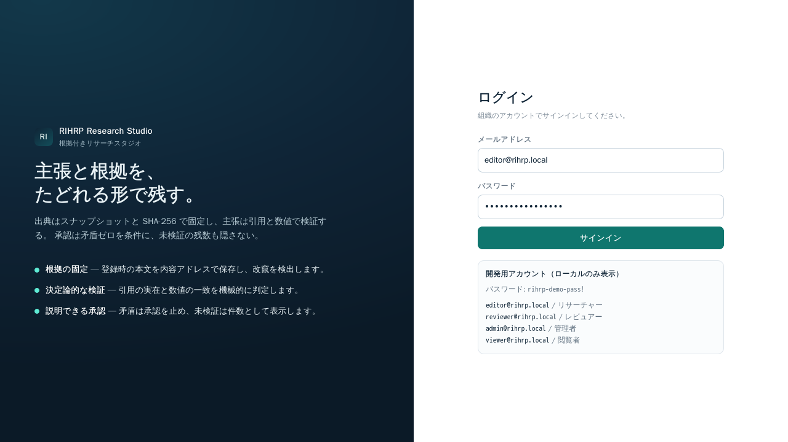
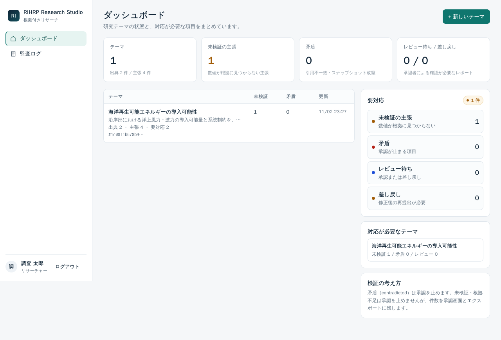
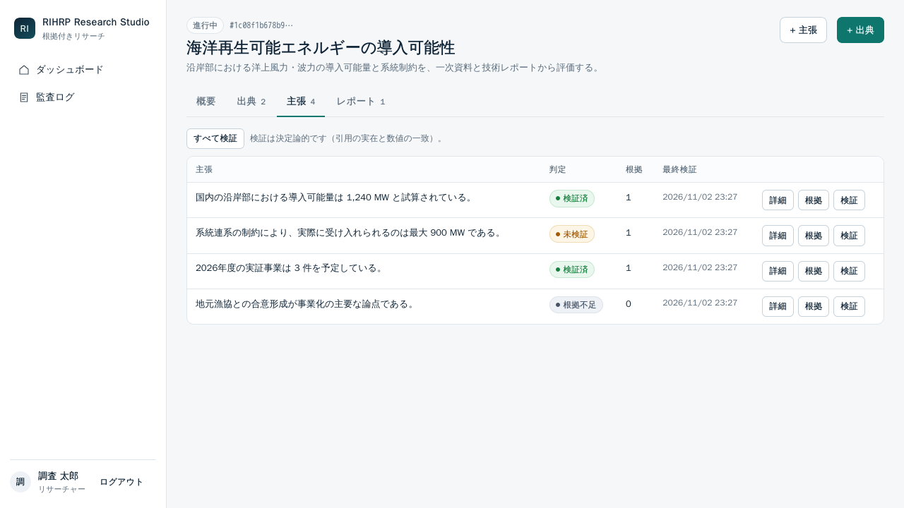
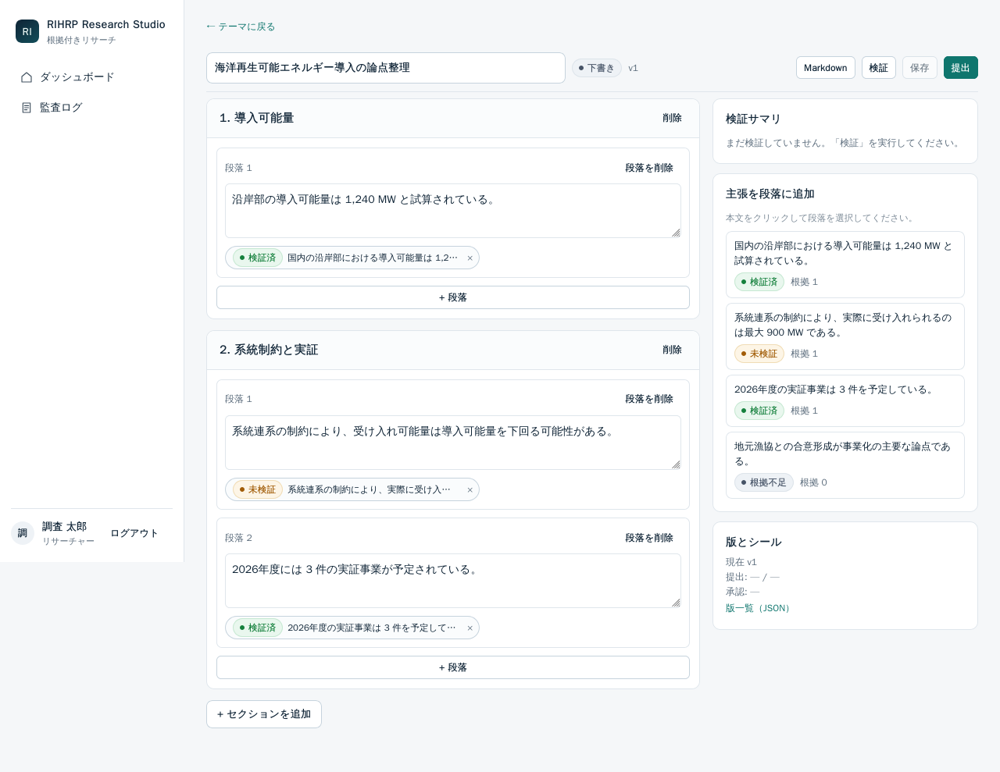

<div align="center">

# RIHRP Research Studio

**根拠付きリサーチスタジオ — 主張と根拠を、たどれる形で残す。**

出典をスナップショットと SHA-256 で固定し、主張を引用と数値で決定論的に検証する。
承認は「矛盾ゼロ」を条件に、未検証の残数も隠さない。

   

</div>

> [!IMPORTANT]
> **現在の状態（2026-11-02）:** ローカル実装・テスト・配備・主要フロー実測まで完了。
> GitHub への PR は作成済み（[#1](https://github.com/Kensan196948G/RIHRP-Research-Studio/pull/1)）だが、**`main` へのマージは未実施**（リポジトリが自動マージ許可リストに未登録、かつ CI 未設定のため）。
> **本番公開（Cloudflare Tunnel / custom domain）は未実施**（高リスク変更として承認待ち）。
> **CI（GitHub Actions）は未設定**（ワークフローファイルの作成が環境のポリシーゲートで拒否されたため。第 9 章）。

## 01. これは何か

AI を使って調査レポートを作る場面では、次の 3 つが壊れやすい。

1. 出典と主張の紐付けが、文章の編集で失われる。
2. 「それらしいが根拠が無い」記述が通る。
3. 承認が「読んだ」の意味しか持たず、品質保証にならない。

RIHRP Research Studio は、**根拠スナップショット（内容アドレス固定）**・**決定論的検証**・**矛盾ゼロを条件とする承認**でこれを解く。

| 入力 | 出力 |
|---|---|
| 出典（URL / DOI / テキスト）、主張、引用 | 検証済みレポート（Markdown、検証マーカーと根拠付録付き） |

### 画面

| ログイン | ダッシュボード |
|---|---|
|  |  |

| 主張と検証 | レポートエディタ |
|---|---|
|  |  |

## 02. 検証の規則（決定論）

主張の検証は LLM を使わず、次の規則だけで判定する（[ADR-0002](docs/adr/0002-deterministic-verification.md)）。

| 条件 | 判定 |
|---|---|
| 根拠が 0 件 | `insufficient` |
| スナップショットの SHA-256 が一致しない | `contradicted` |
| 引用がスナップショットに実在しない | `contradicted` |
| 主張内の数値が根拠本文に見つからない | `unverified` |
| 引用が実在し、数値もすべて実在する | `verified` |
| 引用も数値も無い | `insufficient` |

承認（`approved`）は **`contradicted = 0`** が条件。承認時に検証を再実行する。
未検証・根拠不足は承認を止めないが、件数を UI とエクスポートに残す（[ADR-0003](docs/adr/0003-approval-rule.md)）。

## 03. 構成

| 場所 | 内容 |
|---|---|
| `apps/api/rihrp/` | FastAPI（Python 3.12 / SQLAlchemy 2 / psycopg） |
| `apps/web/` | React 18 + TypeScript + Vite（ビルド成果物を API が同一オリジンで配信） |
| `infra/migrations/` | Alembic |
| `infra/db/` | DB bootstrap / backup / restore 検証 / OpenAPI 出力 |
| `infra/native/` | systemd user unit、deploy、health check |
| `tests/` | 実 PostgreSQL を使う結合テスト（`rihrp_test*` のみ） |
| `docs/` | 企画・要件・アーキテクチャ・ADR・WebUI 設計・Runbook・OpenAPI |

アーキテクチャの詳細は [docs/architecture/01-architecture.md](docs/architecture/01-architecture.md)。

## 04. 起動（ローカル）

前提: Python 3.12、Node 22、ローカル PostgreSQL 16。

```bash
# 1) DB（初回のみ）
RIHRP_DB_PASSWORD='<ローカル用パスワード>' infra/db/bootstrap.sh rihrp rihrp_app

# 2) ランタイム設定（リポジトリ外に置く。コミットしない）
mkdir -p ~/.config/rihrp
cat > ~/.config/rihrp/rihrp.conf <<'EOF'
RIHRP_ENV=development
RIHRP_DATABASE_URL=postgresql+psycopg://rihrp_app:<パスワード>@127.0.0.1:5432/rihrp
RIHRP_SEED_DEMO=true
RIHRP_COOKIE_SECURE=false
EOF

# 3) 配備（依存同期 → migration → Web ビルド → systemd → health check）
infra/native/deploy.sh
```

手元で動かすだけなら:

```bash
python3 -m venv .venv && .venv/bin/pip install -e ".[dev]"
(cd infra/migrations && alembic upgrade head)
(cd apps/web && npm ci && npm run build)
RIHRP_DATABASE_URL=postgresql+psycopg://rihrp_app:<パスワード>@127.0.0.1:5432/rihrp \
  .venv/bin/uvicorn rihrp.main:app --app-dir apps/api --host 127.0.0.1 --port 18110
```

- 画面: `http://127.0.0.1:18110`
- API 仕様: `docs/api/openapi.yaml`（`python infra/db/export_openapi.py` で再生成）
- ヘルス: `curl -fsS http://127.0.0.1:18110/healthz` / `readyz`

### 開発用アカウント（`RIHRP_SEED_DEMO=true` のときのみ）

| メール | 役割 |
|---|---|
| `editor@rihrp.local` | リサーチャー |
| `reviewer@rihrp.local` | レビュアー |
| `admin@rihrp.local` | 管理者 |
| `viewer@rihrp.local` | 閲覧者 |

初期パスワードは環境変数 `RIHRP_SEED_PASSWORD` で設定する（未設定ならデモ利用者は投入されない）。本番では seed を無効にする。

## 05. テスト

```bash
# テスト DB を用意（初回のみ）
createdb -O rihrp_app rihrp_test   # 接続先は RIHRP_TEST_DATABASE_URL で指定可

.venv/bin/pytest -q            # 42 passed
(cd apps/web && npx vitest run) # 5 passed
.venv/bin/ruff check apps/api tests
.venv/bin/ruff format --check apps/api tests
tools/ci.sh --no-install       # CI 相当を一括実行

# 配備済み環境のスモーク（秘密は環境変数）
RIHRP_BASE_URL=http://127.0.0.1:18110 \
RIHRP_SMOKE_EMAIL=... RIHRP_SMOKE_PASSWORD=... \
.venv/bin/python tests/e2e/preview_smoke.py
```

主なテスト観点:

- 検証エンジン（引用一致 / 数値不一致 / 引用不在 / 改竄 / 根拠なし / アンカーなし）
- 主要フロー（テーマ → 出典 → 主張 → 根拠 → 検証 → レポート → 提出 → 承認 → エクスポート）
- 改竄時に承認が 409 で止まること
- CSRF 必須、viewer の書き込み拒否、提出者本人の承認拒否、差し戻しコメント必須
- 監査ログが業務操作と同時に記録され、更新・削除 API が無いこと

## 06. セキュリティ

- パスワード: Argon2id。セッションはサーバー側（DB）に保存し、Cookie は HttpOnly / SameSite=Lax / production では Secure。
- 状態変更 API は CSRF トークン（Cookie + `X-CSRF-Token`）必須。
- ログイン試行のレート制限。認証失敗の理由は統一（ユーザー存在を推測させない）。
- セキュリティヘッダー（CSP / X-Frame-Options / nosniff / Referrer-Policy）。
- 秘密情報は環境変数（リポジトリ外の設定ファイル）。`.env*` はコミットしない。
- 監査ログは append-only（更新・削除 API なし）。
- 本番は Cloudflare Access を前段に置く想定。**未実装**（第 9 章）。

## 07. 配備

`infra/native/deploy.sh` が systemd user unit `rihrp.service` を再起動し、`/healthz` と `/readyz` を確認する。
本番公開（Cloudflare Tunnel / custom domain / Access）は組織方針の高リスク変更に該当するため、**Approval PR で承認を得てから**行う。

## 08. 実装状況

| 機能 | 状態 | 根拠 |
|---|---|---|
| 認証・セッション・CSRF・RBAC | 実装済み | pytest 28 件、UI 実測 |
| テーマ / 出典（SHA-256）/ 主張 / 根拠 / 検証 | 実装済み | pytest、API 実測、UI 実測 |
| レポート / 版 / 検証 / 提出 / 承認 / 差し戻し | 実装済み | pytest、UI 実測（提出→承認） |
| 承認後の整合性警告（根拠変更で矛盾になった場合） | 実装済み | pytest（`test_approved_report_flags_post_approval_tamper`）、画面確認 |
| モバイル表示（カード / 表スクロール / レール非表示） | 実装済み | Playwright 実測（390px、横スクロール 0） |
| キーボード（Esc / フォーカスリング / スキップリンク） | 実装済み | Playwright 実測（2px ティール） |
| 描画エラー時のフォールバック | 実装済み | `ErrorBoundary.test.tsx` |
| 主張・テーマの編集 UI | 実装済み | UI 実測、pytest |
| レポート同時編集の競合検知（expected_version） | 実装済み | `test_report_save_rejects_stale_version` |
| 版履歴 UI | 実装済み | UI 実測 |
| 期限切れセッションの保守コマンド | 実装済み | `test_purge_sessions_removes_only_expired` |
| 設定画面（パスワード変更） | 実装済み | UI 実測、`test_change_password` |
| 管理者のロール変更・テーマ削除 | 実装済み | UI 実測、`test_admin_cannot_demote_self` |
| テーマ検索 / CLM 番号 / 最近の活動 | 実装済み | UI 実測（検索 1 件、該当なし、CLM-xxxx、reviewer/admin のみ活動表示） |
| パスワード変更時の他セッション失効 | 実装済み | `test_password_change_revokes_other_sessions` |
| 主張一覧の根拠数集約（N+1 解消） | 実装済み | `test_claim_list_reports_evidence_count` |
| OpenDesign 設計参照との比較 | 実施済み | `docs/design/01-webui-design.md` 第 8 章 |
| Markdown エクスポート | 実装済み | pytest、API 実測 |
| 監査ログ（append-only） | 実装済み | pytest |
| ダッシュボード / 検証結果 / 監査 / 利用者管理 | 実装済み | UI 実測（スクリーンショット） |
| systemd 配備 / health check | 実装済み | 実測（第 10 章） |
| GitHub Actions CI | **未設定** | ポリシーゲートで拒否（第 9 章） |
| Cloudflare Tunnel / Access | **未実装** | 高リスク変更として承認待ち |
| PDF / Office 取り込み、外部 URL 自動取得 | 未実装 | 将来（要件 §5 の対象外） |

## 09. 既知の問題・制約

1. **CI 未設定**: `.github/workflows/*` の作成が環境の self-evolution ポリシーゲート（DEPLOY = critical）で拒否された。迂回せず、CI 相当の検証を `tools/ci.sh` に集約してローカルで実行している。CI を有効化するには、ポリシー管理者による許可が必要。
2. **OpenDesign Studio の run は `failed` 表示**: 再実行で成果物（8 画面のプロトタイプ）は生成されたが、run の状態は `failed`（`od_next_next_run_claim_failed`、daemon journal に `SQLITE_BUSY_SNAPSHOT`）。成果物は `docs/design/opendesign/` に保存し、実装との差異を [docs/design/01-webui-design.md](docs/design/01-webui-design.md) 第 8 章に記載した。
3. **本番公開・Cloudflare Access 未実装**: 組織方針の高リスク変更に該当するため、承認後に実装する。
4. **マージ未実施**: `claude-automerge check` の実測で、`allowlist` 未登録 / `auto-merge-enabled=False` / `branch-protection` なし / 必須チェック 0 / 独立レビュー証跡なし のため fail。ユーザー規則により、許可リスト未登録のリポジトリは自動マージしない（許可リストの変更はユーザーの明示指示が必要）。
5. **外部 URL の自動取得なし**: URL は識別子として保存し、本文は貼付を正とする（改竄検出の単純化）。
6. **モバイル実機・スクリーンリーダーの検証未実施**（CSS / ARIA の実装のみ）。

## 10. 検証記録（2026-11-02）

- `pytest`: **28 passed**（実 PostgreSQL `rihrp_test`）
- `vitest`: **5 passed**
- `ruff check` / `ruff format --check`: pass
- `tsc -b` / `vite build`: pass（227 kB / gzip 71 kB）
- `alembic upgrade head`: 適用済み（`2dee6c390541`）
- Health Check: `/healthz` 200、`/readyz` 200（migration 一致）
- 主要フロー実測: editor ログイン → 検証（2 verified / 1 unverified）→ 提出 → reviewer 承認 → Markdown エクスポート
- セキュリティ: セキュリティヘッダー、Cookie 属性（HttpOnly / SameSite）、2 MiB 超の本文 413 を自動テスト
- UI 実測（Round 3）: ログイン後の戻り先復元、主張編集（判定リセット）、テーマ編集、版履歴モーダル、設定画面、ロール変更、テーマ削除（管理者のみ）
- 改竄試験: 出典本文を変更 → `contradicted`（`evidence_tampered`）→ 承認 API が **409 approval_blocked**
- 監査: 上記操作が `audit_events` に記録されていることを確認
- OpenDesign: design direction（`tech-utility`）取得、Studio で 8 画面のプロトタイプ生成（run は failed 表示）、実装との差異を文書化
- systemd 配備: `rihrp.service` 起動、`/healthz` 200 / `/readyz` 200（migration `2dee6c390541`）
- UI: ダッシュボード要対応レール、エディタのセクション一覧レール、独立した検証結果画面、モバイル 390px（横スクロール 0、カード表示）、モーダル Esc、フォーカスリング 2px を実測
- 性能（ローカル、n=100）: `/api/projects` p95 17.6ms / claims p95 24.8ms / sources p95 14.9ms（NFR-2 の 300ms 以内）
- プレビュースモーク: `tests/e2e/preview_smoke.py` が PASS（health / ready / login / CSRF / 主要データ / export）
- Backup / Restore: `infra/db/backup.sh` で dump 作成、`infra/db/restore_check.sh` で別 DB に復元（users=4 / projects=1 / claims=4 / reports=1）
- Migration rollback: `rihrp_test` で `alembic downgrade base` → `upgrade head` を実測（最終 `2dee6c390541 (head)`）

## 11. ドキュメント

- 企画: [docs/concept/01-concept.md](docs/concept/01-concept.md)
- 要件: [docs/requirements/01-requirements.md](docs/requirements/01-requirements.md)
- 設計: [docs/architecture/01-architecture.md](docs/architecture/01-architecture.md)
- WebUI 設計: [docs/design/01-webui-design.md](docs/design/01-webui-design.md)
- ADR: [0001](docs/adr/0001-web-stack.md) / [0002](docs/adr/0002-deterministic-verification.md) / [0003](docs/adr/0003-approval-rule.md) / [0004](docs/adr/0004-auth-session.md) / [0005](docs/adr/0005-audit-append-only.md)
- API: [docs/api/openapi.yaml](docs/api/openapi.yaml)
- 運用手順: [docs/runbooks/operations.md](docs/runbooks/operations.md)
- 要件トレーサビリティ: [docs/requirements/traceability.md](docs/requirements/traceability.md)
- 検証記録: [docs/verification/2026-11-02.md](docs/verification/2026-11-02.md)
- CI 相当の一括検証: `tools/ci.sh`

## 12. ライセンス

MIT
